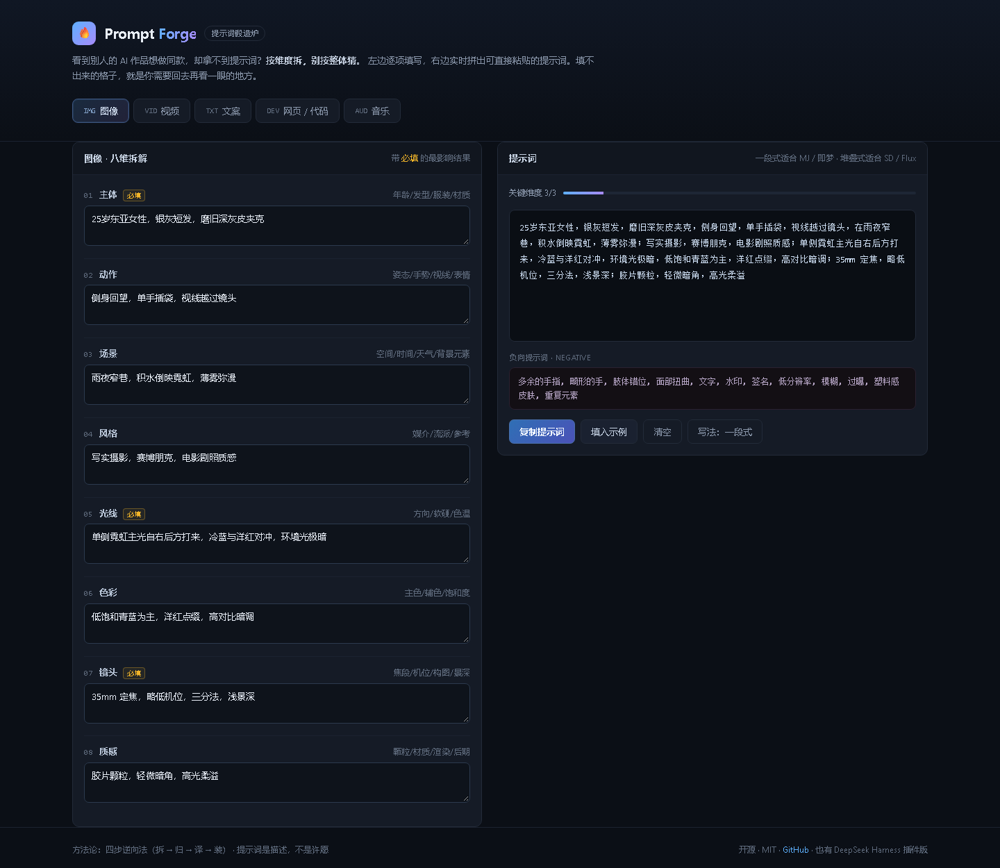

# Prompt Forge · 提示词锻造炉

> 看到别人的 AI 作品想做同款，却拿不到提示词？
> **按维度拆，别按整体猜。**

一个帮你把「我想要这种效果」变成可复现提示词的开源工具。覆盖**图像 / 视频 / 文案 / 网页代码 / 音乐**五个品类，同时提供网页版和 DeepSeek Harness 插件版。

[](LICENSE)
[](https://github.com/topics/dsh-plugin)
[](https://deepseek-harness.github.io/deepseek-harness/)



---

## 你大概遇到过这个

刷到一张图、一段视频、一篇笔记，心里想「这个我也能做」，然后翻遍评论区找不到提示词。作者只说了一句「随便跑的」。

于是你照着感觉写：

> 一个很酷的赛博朋克女孩，未来感，超高清，8k，杰作

出来的东西跟参考差了十万八千里。不是模型不行，是这段话里**没有一个模型能落地的信息**。

Prompt Forge 解决的就是这件事：把「很酷」「高级感」「氛围感」这类对人是信息、对模型是噪声的词，换成**光线、材质、镜头、焦段、色温**这些能被拍出来、画出来、执行出来的物理事实。

---

## 核心方法：四步逆向法

看到作品想复现，按这四步走，而不是整体瞎猜。

**第 1 步：拆。** 不要整体描述，先把画面拆成可命名的零件。画面里有什么、在干什么、在哪、怎么被拍下来的。拆到能用名词说清每一项为止。

**第 2 步：归。** 把零件塞进固定维度。这一步的意义是防漏——漏掉哪一格，模型就在哪一格自由发挥，而它发挥的结果通常不是你想要的。

**第 3 步：译。** 日常语言翻译成模型认识的术语。这一步最容易拉开差距。

| 你想说的 | 写进提示词的 |
|---|---|
| 看起来很贵 | 丝绒质感、黄铜配件、低饱和暖调、柔光箱打光 |
| 很孤独 | 大面积负空间、主体偏右下、冷蓝调、单点光源 |
| 很梦幻 | 柔焦、丁达尔光、粉紫补光、浅景深 |
| 很有科技感 | 冷白 LED 边缘光、亚克力反光、青蓝色调、超广角 |

**第 4 步：装。** 按骨架顺序组装。顺序即权重，越靠前模型越当回事。

### 八维骨架（图像 / 视频通用）

主体 → 动作 → 场景 → 风格 → 光线 → 色彩 → 镜头 → 质感

时间紧就只填**主体、光线、镜头**这三项，效果已经能拉开明显差距。光线和镜头是最常被漏掉、也最影响成片质量的两项。

完整方法论见 [`docs/method.md`](docs/method.md)，各品类的维度清单、术语库、模板和避坑指南在 [`skills/prompt-forge/references/`](skills/prompt-forge/references/)。

---

## 三种用法

### 一、网页版（最快，不用装任何东西）

打开 **<https://stephen-pc.github.io/prompt-forge/>**

左边按维度逐项填，右边实时拼出提示词，一键复制。填不出来的格子，正好提示你回去再看一眼参考作品。

也可以直接下载 [`docs/index.html`](docs/index.html) 双击打开——单文件、零依赖、不联网、不上传任何内容。

### 二、DeepSeek Harness 插件

装进 DSH 之后，直接在对话里说「我想做一个这种效果的图，帮我拆一下」，它会按同一套方法论追问、拆解、组装。

```bash
# 从 GitHub 安装
dsh plugin --profile web add github:Stephen-pc/prompt-forge

# 或从 npm 安装（发布后可用）
dsh plugin --profile web add dsh-prompt-forge
```

装完确认一下配置里出现了这一层：

```bash
dsh --profile web --dump-config
```

启动后 skill 会自动同步到 `~/.dsh/skills/prompt-forge/`。

如果 skill 没出现在目录里（少数情况下 harness 的 skill 提供方未启用），手动挂一次：

```bash
mkdir -p ~/.dsh/skills
cp -r skills/prompt-forge ~/.dsh/skills/
```

### 三、只读方法论

不需要工具，直接读 [`docs/method.md`](docs/method.md)。核心就一句话：

> **提示词是描述，不是许愿。** 每一句都应该是「画面里能被看见的东西」。

---

## 五个品类

- **图像** —— 八维拆解，一段式（MJ / 即梦）与堆叠式（SD / Flux）两种写法，附通用负向提示词
- **视频** —— 十维拆解，重点是写「怎么动」而不是「长什么样」，含镜头运动术语表
- **文案** —— 八维拆解，平台语气对照、六种钩子写法、让文案不像 AI 写的五条
- **网页 / 代码** —— 七维拆解，核心是约束而非许愿，含边界条件清单
- **音乐** —— 七维拆解，子流派术语库、情绪弧线写法、Suno / Udio 的段落标签用法

每个品类都包含：维度速查、术语库、可直接套用的模板、避坑清单。

---

## 仓库结构

```
prompt-forge/
├── package.json          # dsh.bundle 声明
├── cordis.patch.yml      # 组合包配置层
├── index.js              # 插件入口：把 skill 同步到 ~/.dsh/skills
├── skills/
│   └── prompt-forge/
│       ├── SKILL.md      # skill 主文件（DSH 读取）
│       └── references/   # 五个品类的细则
├── docs/
│   ├── index.html        # 网页版工具（GitHub Pages 入口）
│   ├── method.md         # 完整方法论
│   └── screenshot.png
├── LICENSE
└── README.md
```

仓库根目录本身就是 DSH 插件包，所以 `dsh plugin add github:...` 可以直接装，不需要额外的子目录路径。

---

## 常见问题

**为什么不能百分之百复刻别人的作品？**
模型有随机性，同一段提示词跑十次也不完全一样。这套方法能保证「同风格、同质感、同结构」，但做不到像素级一致。任何承诺能完全复刻的说法都不诚实。

**为什么插件要往 `~/.dsh/skills/` 写文件？**
那是 DSH 官方文档列明的默认 skill 扫描根目录之一（rank 400），harness 会监视它并在变化时自动刷新，不需要任何内部 API。这是最稳的分发方式。插件只复制自己 `skills/` 下的目录，不会碰你手写的 skill。

**填了这些维度，提示词会不会太长？**
会长，但长不是问题，空才是问题。多数模型对 100–200 词的结构化描述处理得很好。真正的浪费是堆 `8K, ultra detailed, masterpiece` 这类无信息量的词。

**能不能自动从图片反推提示词？**
那是另一个问题（视觉反推），需要多模态模型。本项目的定位是**给你一套拆解框架和术语库**，让你自己看得懂、写得对。工具负责防漏和组装，判断还是得你来。

---

## 参与

发现某个品类缺维度、术语不准确、或者有更好的模板，欢迎提 PR。新增品类只需要在 `skills/prompt-forge/references/` 加一个文件，并在 SKILL.md 的品类表里登记。

---

## License

[MIT](LICENSE)
